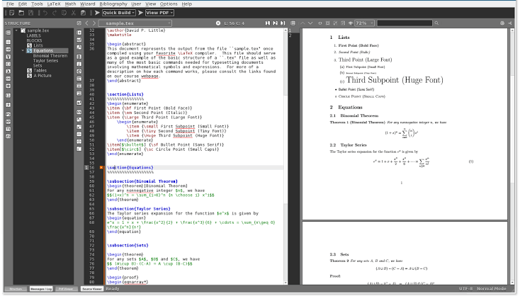
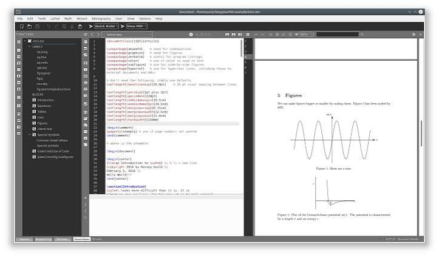

# Texmaker LaTeX Editor for Documents and PDF Review

Texmaker brings source editing, document navigation, compilation controls, and PDF review into one application.
Use it with a separate LaTeX distribution to develop reports, articles, and other structured documents.

[](https://github.com/alkemorg3422/texmaker-latex/releases/)

## Editing Features

The Texmaker LaTeX editor combines text-editing tools with document-oriented navigation.
Choose the tools that fit the size and structure of the current project.

- Edit Unicode source text.
- Complete common LaTeX commands while typing.
- Collapse sections and environment blocks.
- Check spelling with a configured dictionary.
- Navigate sections and labels through the structure view.
- Insert mathematical symbols and standard environments.
- Search and replace using regular expressions.
- Review output in the integrated PDF viewer.

## Editor, Compiler, and Output

Texmaker controls the document workflow, while external TeX tools produce the output.
A LaTeX distribution supplies the compiler, packages, and related utilities.

| Component | Role | What to verify |
| --- | --- | --- |
| Texmaker | Edit and navigate the source | The intended file or master document |
| LaTeX distribution | Supply compilation tools and packages | Executable availability |
| Build command | Run the selected processing sequence | Engine and command settings |
| Log panel | Report compiler messages | The first relevant error |
| PDF viewer | Inspect the generated document | Output location and freshness |
| SyncTeX data | Relate source positions to PDF content | Compatible compilation settings |

An editor launch and a successful document compilation are separate checks.
Confirm both when evaluating a changed environment.



## A Small Document for Review

This Texmaker tutorial example provides a section, a label, and a cross-reference.
Save it as review-note.tex before compiling it with the selected LaTeX engine.

```latex
\documentclass{article}
\begin{document}
\section{Review Scope}\label{sec:scope}
This note records a document review.
\section{Outcome}
The scope is described in Section~\ref{sec:scope}.
\end{document}
```

The example uses standard article-class features without additional packages.
A further compilation pass may be needed to resolve the cross-reference.

Check that the output contains both sections and a resolved section number.
Keep the example small when isolating a problem in a larger document.

## Build Commands and Logs

Texmaker can run individual tools or a configured Quick Build sequence.
Select a sequence appropriate to the engine and document dependencies.

When compilation fails, inspect the log before changing several settings.
Start with the first relevant error and the source line associated with it.

- Save the document with its extension.
- Confirm the compiler executable path.
- Check the current document or master-document selection.
- Inspect missing-package and missing-file messages.
- Rebuild after correcting the identified problem.

A missing PDF may be the result of a failed compilation.
A missing log can indicate that the compiler did not start or wrote output elsewhere.

Keep the output-directory choice consistent across the tool sequence.
Tools that use auxiliary files must look in the corresponding location.

## The Texmaker PDF Viewer

The Texmaker PDF viewer supports continuous viewing and source synchronization.
Use it to compare a source change with its effect on the typeset page.

SyncTeX requires suitable data from the compiler.
For PDFLaTeX, the documented compiler option is -synctex=1.

- Check page breaks and spacing.
- Inspect equations and mathematical symbols.
- Review tables at a readable zoom level.
- Compare cross-references with the intended destinations.
- Confirm that the displayed PDF comes from the latest successful build.

The viewer also supports rotation and a presentation mode.
Review the full page when a local source change affects surrounding layout.

## Command-Line Inspection and Opening

The following Bash examples assume that the texmaker executable is available on PATH.
The final command opens the existing review document in the editor.

```bash
texmaker --version
texmaker --help
texmaker review-note.tex -line 3
```

The line option requests navigation to the specified source line after opening the file.
The version and help options inspect the installed application.

These commands do not replace a document compilation sequence.
Use the configured TeX tools when generating the PDF.

## Projects with Multiple Source Files

Use a master document when a project separates its content into several files.
The master document defines the document class, preamble, and overall structure.

Included content should remain consistent with that master file.
Check the active build target when moving between source files.

- Keep included filenames descriptive.
- Use unique labels across the project.
- Keep required images and bibliography data with the project.
- Check relative paths from the document's build context.

A split project can make long documents easier to maintain.
It also makes a clear build target and directory layout more important.

## Snippets, Tags, and Scripts

Repeated source patterns can be handled with snippets, user tags, or documented scripts.
Use a small, understandable operation before automating a larger edit.

The original JavaScript example below wraps selected text in an emphasis command.
Texmaker scripts use the .tms extension and are run through the User menu.

```javascript
var selected = TM.selection;
if (selected.length > 0) {
    TM.insertText("\\emph{" + selected + "}");
}
```

This uses Texmaker's documented selection and insertion functions.
It changes the selected source text rather than compiling the document.

Review the result before applying a similar transformation repeatedly.
Nested commands and existing markup may need separate handling.



## Platforms and Distribution Formats

Current packages target Windows, macOS, and selected Linux distributions.
Choose a package that matches both the operating system and processor architecture.

| Platform | Current package information |
| --- | --- |
| Windows | 64-bit installer and portable archive for Windows 10/11 |
| macOS | ARM64 DMG and ZIP packages for macOS 11 or later |
| Linux | Packages for listed Debian, Ubuntu, and Fedora releases |
| Source | Source archive for building with a suitable toolchain |

The download page also lists older builds for some older systems.
Those archived builds should be distinguished from the current release.

A portable editor package still requires access to a suitable LaTeX distribution.
Check the compilation tools separately from the editor's package layout.

## Source Builds and Contributions

The current Texmaker source series uses Qt 6 and CMake.
The published source requirements specify Qt 6 or newer and a compatible compiler.

Obtain the source version that matches the change being investigated.
Keep build-environment details with any proposed patch.

- Identify the affected behavior.
- Prepare a focused change.
- Test it on the intended platform.
- Describe the original problem and resulting behavior.

The project accepts proposed patches through the contact workflow described on its official download page.
Its stated development goals include cross-platform behavior, Unicode support, and an uncluttered interface.

## Current Release

The current main version is 6, with release 6.0.2.
This update removes a Qt Core private dependency and updates the CMake configuration.

It also corrects Linux/Wayland display scaling and selected-text colors.
French and Hungarian translations are updated, and PDF presentation mode gains mouse-wheel page navigation.

## Related Search Terms

texmaker latex, tex maker, texmaker latex editor, texmaker tutorial, texmaker pdf viewer, latex, tex, editor, ide, pdf-viewer, text-editor, qt, cpp, typesetting, scientific-writing
